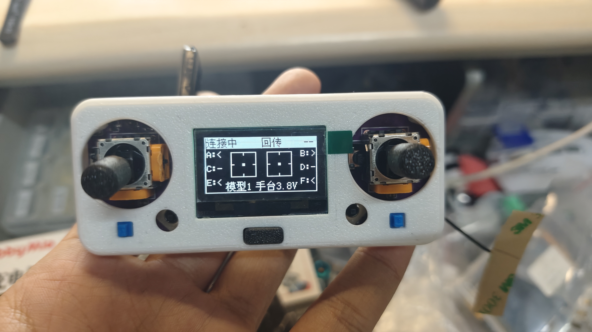

# ZOE_TX V1.2

[](LICENSE)
[](https://github.com/dlxtsvaksu/ZOE_TX/releases/latest)


基于 **STM32F103C8T6** 的开源航模遥控器固件：CRSF 双向链路 + PPM 输出 + USB HID 手柄 + 128×64 OLED 多页菜单，
支持 8 个模型、通道混控、微调、摇杆校准与掉电保存。

> 本工程是为自制硬件配套的固件，默认引脚定义见 `Core/Inc/main.h` 和 `ZOE_TX_V1.2.ioc`。
> 换板、换屏或改外设前请先对照原理图，必要时用 STM32CubeMX 重新生成底层初始化代码。

---
## 实物展示



## 功能特性

- **CRSF 双向通信**：USART2 @ 400 kbaud（DMA 收发），TIM1 每 4 ms 触发一次，250 Hz 发送 `0x16` 遥控帧；
  解析 `0x14` 链路统计、`0x08` 接收机电池、`0x28`/`0x29` 设备信息，支持对频等 `0x32` 命令帧。
- **PPM 输出**：TIM4_CH1（PB6）输出标准 PPM，默认 8 通道 / 22.5 ms 帧（44.4 Hz），宏可配置 1~16 通道。
- **USB HID 摇杆**：USB 全速设备，9 字节报告（X / Y / Z / Rz + 8 个按键），Windows/Linux 免驱识别为游戏手柄。
- **OLED 界面**：I2C2 @ 400 kHz 驱动 128×64 屏（默认 SH1106，可切 SSD1306 / SSD1315 / CH1116），
  含摇杆页、通道页、通道条页、菜单、诊断页、混控/模型/输入映射/微调分配/版本页。
- **混控**：8 个模型（`MODEL_MAX`），最多 64 条混控记录（所有模型共用，`MIX_MAX`），每通道最多 4 个输入源（AETR + 开关 A~F），权重 ±100%。
- **微调**：4 组 trim，行程 ±20%，按键长按加速，可把任意微调挂到任意输出并取反。
- **校准与持久化**：4 轴中位/行程校准、输入映射、方向、微调分配写入内部 Flash 最后一页，上电自动恢复。
- **电源管理**：长按电源键 1.2 s 开机（`PWR_EN` 锁存供电），再长按 3 s 软关机；
  另提供自锁开关版固件开关（`BoardCfg.h` 的 `BOARD_PWR_VERSION`）。
- **非阻塞调度**：`Schedule.c` 用 1 / 5 / 10 ms 时间片轮询任务，OLED 按 `OLED_FRAME_BUDGET_MS` 分页推送，避免长时间阻塞。

## 硬件与外设

| 功能 | 引脚 | 说明 |
| --- | --- | --- |
| 摇杆 4 轴 | PA0 / PA1 / PA4 / PA5 | ADC1_IN0/IN1/IN4/IN5，DMA 循环采样；默认顺序 Ail/Ele/Thr/Rud，可在「输入映射」里改 |
| 电池电压 | PA6 | ADC1_IN6，10k+10k 分压；低压阈值见 `Func.h` 的 `BATT_LOW_MV` |
| OLED | PB10 / PB11 | I2C2 SCL / SDA，400 kHz，128×64 |
| CRSF | PA2 (TX) / PA3 (RX) | USART2 400000 8N1，DMA 收发 |
| PPM 输出 | PB6 | TIM4_CH1，1 µs 时基 + 输出比较翻转 |
| USB HID | PA11 (D-) / PA12 (D+) | USB 全速设备，HID 摇杆 |
| 电源键 | PB13 | 输入下拉，按下读高（长按开关机版） |
| 电源保持 | PB14 | 推挽输出，锁存后拉高维持供电 |
| 状态 LED | PB15 | 开漏输出 |
| 充电检测 | PB12 | 输入上拉 |
| USB 检测 | PA13 | 输入下拉 |
| 开关 A / B / E / F | PA8 / PB9 / PA7 / PC13 | 输入上拉，单引脚两档 |
| 开关 C / D | PB0+PB1 / PC14+PC15 | 双引脚组合，可区分三档 |
| 微调 / 导航键 | PB8 PB7 PB5 PB4 PB3 PA15 PA10 PA9 | TRIM1~TRIM8，输入上拉；UP=TRIM1、DOWN=TRIM4、ENTER=TRIM3、EXIT=TRIM2 |
| 调试口 | PA13 / PA14 | 固件关闭了 SWJ（见下方「烧录与调试」） |

## 下载固件

已编译好的固件见 [Releases](https://github.com/dlxtsvaksu/ZOE_TX/releases/latest)：

- `ZOE_TX_V1.2.elf` —— 带符号，STM32CubeProgrammer / ST-Link 直接下载
- `ZOE_TX_V1.2.bin` —— 裸二进制，烧录地址 `0x08000000`
- `ZOE_TX_V1.2.hex` —— Intel HEX，任意 STM32 烧录工具可用

## 构建

依赖：

- CMake ≥ 3.22
- Ninja
- `arm-none-eabi-gcc`（已验证 STM32CubeCLT 的 GNU Tools for STM32 14.3.1+st.2）

把 `arm-none-eabi-gcc`、`cmake`、`ninja` 加入 `PATH`（安装 STM32CubeCLT / STM32CubeIDE 时会一并提供），然后在仓库根目录：

```bash
# Debug（-O0 -g3）：用于索引/单步调试，注意 64 KB Flash 装不下（约 94 KB）
cmake --preset Debug
cmake --build --preset Debug

# Release（-Os）：可烧录版本，当前约 52 KB Flash / 10.4 KB RAM
cmake --preset Release
cmake --build --preset Release
```

> ⚠️ 使用 **STM32F103C8T6（64 KB Flash）** 时，`Debug` 预设会链接失败：
> `region 'FLASH' overflowed by 28588 bytes`（约 94 KB）。这是 `-O0` + 中文字库 + UI 的正常结果，
> 请用 `Release` 烧录；若确实要调试，可减少 `MODEL_MAX`/`MIX_MAX`、裁剪字体或改用更大 Flash 的型号。

产物：`build/Debug/ZOE_TX_V1.2.elf`、`build/Release/ZOE_TX_V1.2.elf`（链接时同时生成 `.map`）。
需要 `.bin` / `.hex` 时可自行转换：

```bash
arm-none-eabi-objcopy -O binary build/Release/ZOE_TX_V1.2.elf ZOE_TX_V1.2.bin
arm-none-eabi-objcopy -O ihex   build/Release/ZOE_TX_V1.2.elf ZOE_TX_V1.2.hex
```

> VS Code 的 STM32 扩展用户可直接用 CMake 面板选择 `Debug` / `Release` 预设。
> `.clangd` 指向 `build/Release`，想要代码补全/跳转请至少配置一次 Release 预设。

## 烧录与调试

```bash
# ST-Link + STM32CubeProgrammer CLI
STM32_Programmer_CLI -c port=SWD -d build/Release/ZOE_TX_V1.2.elf -rst
# 或只烧 bin
STM32_Programmer_CLI -c port=SWD -d ZOE_TX_V1.2.bin 0x08000000 -rst
```

> ⚠️ **注意**：`Core/Src/stm32f1xx_hal_msp.c` 里调用了 `__HAL_AFIO_REMAP_SWJ_DISABLE()`，
> 运行后 **JTAG 与 SWD 都被关闭**（PA13/PA14 被当作普通 GPIO：`USB_DETECT` / `TRIM_MODE`）。
> 因此：
> - 用 ST-Link 时选 **Connect under reset**（复位期间仍可连上 SWD）；
> - 或者把 `BOOT0` 拉高，用 **USART1 串口 ISP** 烧录（本板 PA9/PA10 还接着 TRIM8/TRIM7，
>   烧录前请确认这些按键不会把串口拉死）；
> - 若需要在线调试，请把该行改成 `__HAL_AFIO_REMAP_SWJ_NOJTAG()`，并在 CubeMX 中释放 PA13 / PA14
>   对 `USB_DETECT` / `TRIM_MODE` 的占用（同时注意 PB3 / PB4 也会重新变成 JTAG 复用）。

## 目录结构

```text
ZOE_TX_V1.2/
├─ Core/                 # CubeMX 生成的启动/时钟/外设初始化(含 USER CODE 段)
├─ Drivers/              # STM32F1 HAL + CMSIS(第三方, 许可见各自 LICENSE.txt)
├─ Middlewares/ST/       # STM32 USB Device Library(第三方, SLA0044)
├─ Task_Schedule/        # 应用层
│  ├─ Schedule.c/.h      #   时间片任务表 + 电源键状态机
│  ├─ Func.c/.h          #   ADC 滤波/校准、AETR 换算、开关/按键、微调、混控
│  ├─ Crsf.c/.h          #   CRSF 协议收发与解析(250 Hz)
│  ├─ Ppm.c/.h           #   PPM 输出(8ch / 22.5ms)
│  ├─ Store.c/.h         #   内部 Flash 参数保存/恢复
│  ├─ Ui.c/.h            #   OLED 页面与菜单逻辑
│  ├─ UsbHid.c/.h        #   USB HID 摇杆上报
│  ├─ BoardCfg.h         #   硬件版本开关(自锁开关版 / 长按开关机版)
│  └─ usbd_conf.c, usbd_desc.c  # USB 设备配置与描述符
├─ oled_multi/           # OLED 驱动 + 中英文字库(移植自 keysking 教程驱动)
├─ hardware/             # PCB / 外壳源文件与制造文件(见 hardware/README.md)
├─ docs/images/          # README 用界面截图与实物照片
├─ cmake/                # 工具链文件 + CubeMX 源文件列表
├─ ZOE_TX_V1.2.ioc       # STM32CubeMX 工程
├─ CMakeLists.txt / CMakePresets.json
├─ STM32F103xx_FLASH.ld  # 链接脚本
└─ startup_stm32f103xb.s # 启动文件
```

## 硬件资料（PCB / 外壳 / 图片）

- PCB 源工程、Gerber / BOM / 坐标文件：`hardware/pcb/`
- 外壳 3D 模型（STEP / STL / CAD 源工程）：`hardware/enclosure/`
- 界面截图与实物照片：`docs/images/`（README 中直接引用）
- 命名规范、体积限制、隐私检查与硬件许可说明见 [hardware/README.md](hardware/README.md)

## 常用配置项

| 想改什么 | 改哪里 |
| --- | --- |
| 自锁开关版 / 长按开关机版 | `Task_Schedule/BoardCfg.h` → `BOARD_PWR_VERSION` |
| PPM 通道数 / 帧长 / 脉宽 | `Task_Schedule/Ppm.h` → `PPM_CH`、`PPM_FRAME_US`、`PPM_PULSE_US` |
| 模型数 / 混控上限 / 每通道输入源数 / 微调步进 | `Task_Schedule/Func.h` → `MODEL_MAX`、`MIX_MAX`、`MIX_PER_CH`、`TRIM_*` |
| OLED 驱动芯片 / SH1106 DCDC 模式 | `oled_multi/oled.c` → `OLED_CHIP`、`OLED_SH1106_DCDC_MODE` |
| OLED 每帧推送预算（帧率 vs 阻塞） | `oled_multi/oled.c` → `OLED_FRAME_BUDGET_MS` |
| 电池低压阈值 / 分压比 | `Task_Schedule/Func.h` → `BATT_LOW_MV`、`BATT_DIV_X1000` |
| CRSF 链路超时、地址、帧类型 | `Task_Schedule/Crsf.h` |
| 通道中位死区 | `Task_Schedule/Func.c` → `ADC_DEADBAND` |

## 界面与按键

- **导航键**：UP / DOWN 移动焦点（到顶/到底循环，长按加速），ENTER 进入或执行，EXIT 返回；
  对应实体键 TRIM1 / TRIM4 / TRIM3 / TRIM2（PB8 / PB4 / PB5 / PB7）。
- **电源键短按**（40~700 ms）：切换「微调模式」；此模式下 8 个 TRIM 键用于微调步进。
- **主菜单**：混控 / 模型 / 系统 / 对频；「系统」下含校准、输入映射、微调分配、版本、返回。
- **校准**：进入后按提示推满各轴并回中，结果写入 Flash；若行程异常会用默认值兜底并在界面提示。

## 用 CubeMX 重新生成代码

1. 用 STM32CubeMX / STM32CubeIDE 打开 `ZOE_TX_V1.2.ioc`；
2. 只改外设与引脚，**不要删除 `/* USER CODE BEGIN ... */` ~ `/* USER CODE END ... */` 之间的内容**；
3. 生成代码时选择 CMake 工具链，覆盖 `Core/`、`Drivers/`、`cmake/stm32cubemx/`；
4. `CMakeLists.txt` 中用户添加的源文件与 include 路径不会被 CubeMX 覆盖，但新增的应用源文件需手动加入
   `target_sources(...)`。

## 许可证

本项目自身代码采用 **MIT License**，见 [LICENSE](LICENSE)。
`Drivers/`、`Middlewares/ST/` 等第三方组件的授权另计，详见 [THIRD_PARTY_NOTICES.md](THIRD_PARTY_NOTICES.md)。

## 贡献

欢迎提 Issue / PR：请尽量附上硬件版本（自锁开关版或长按开关机版）、复现步骤与串口/屏幕现象。
提交前请确认 `cmake --preset Release && cmake --build --preset Release` 能通过。

## 致谢

- STMicroelectronics：STM32F1 HAL、CMSIS、STM32 USB Device Library
- 波特律动（keysking）：OLED 驱动与字库思路
- ExpressLRS / TBS CRSF 协议文档与社区资料

> 航模设备有风险，请务必先在无桨/断桨条件下验证通道方向、失控保护与电源时序。

